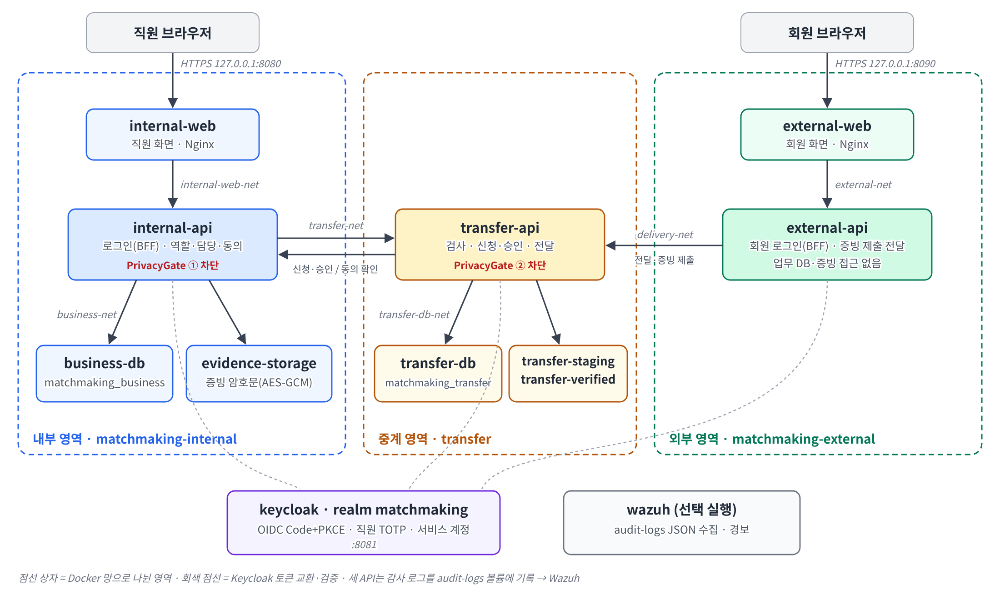

# PrivacyGate 아키텍처 설계

2026년 11월 5일 · 이세빈 · 명칭 규칙 최신본 반영

## 1. 한눈에 보기

직원용 내부 영역과 회원용 외부 영역을 나누고, 두 영역 사이에는 중계 서버(transfer-api) 하나만 둔다. PrivacyGate 검사는 내부 API(자료를 만들기 전)와 중계 서버(자료를 내보내기 전) 두 곳에서 일어난다.

점선 상자는 Docker 네트워크로 나뉜 영역이다. external-api에서 업무 DB·증빙 저장소로 가는 선은 없으며, 모든 API는 Keycloak(realm `matchmaking`)으로 사용자를 확인하고 감사 로그를 Wazuh로 보낸다.

## 2. 구성 요소와 책임

| 서비스 | 영역 | 역할 | 기술 | 레포 |
| --- | --- | --- | --- | --- |
| internal-web | 내부 | 직원 화면: 회원 조회·반출 신청·증빙 심사·승인 | HTML/JS, Nginx | matchmaking-internal |
| internal-api | 내부 | 업무 API, 직원 로그인(BFF), 역할·담당·동의 검사, 증빙 암호화 (**PrivacyGate**) | FastAPI | matchmaking-internal |
| business-db | 내부 | `matchmaking_business`: 사용자·회원·담당·동의·증빙 메타·세션·감사 기록 | PostgreSQL 16 | privacygate/infra/db |
| evidence-storage | 내부 | AES-GCM 암호화된 증빙 원본 | Docker 볼륨 | — |
| transfer-api | 중계 | 반출 파일 검사, 신청·승인·회수, 전달 시 승인 파일 검증 (**PrivacyGate**) | FastAPI | matchmaking-external |
| transfer-db | 중계 | `matchmaking_transfer`: 반출 파일·신청·승인·전달·감사 기록 | PostgreSQL 16 | privacygate/infra/db |
| transfer-staging / transfer-verified | 중계 | 검사 전 파일 / 검사 통과 파일 | Docker 볼륨 | — |
| external-api | 외부 | 회원 로그인(BFF), transfer-api만 호출 | FastAPI | matchmaking-external |
| external-web | 외부 | 회원 화면: 증빙 제출·전달 목록·다운로드·거부·만료 안내 | HTML/JS, Nginx | matchmaking-external |
| keycloak | 인증 | OIDC 로그인, 직원 TOTP, 서비스 계정 | Keycloak 26 | privacygate/infra |
| wazuh | 관제 | JSON 로그 수집·규칙·경보 | Wazuh 4 (선택 실행) | privacygate/infra |

공통 보안 모듈 `privacygate`(Python 패키지)는 internal-api와 transfer-api가 함께 쓴다: 역할 판단, 직무 분리, 세션·CSRF 규칙, 오류 응답 형식, 감사 로그, 승인 파일 검증(`delivery_problem`), 기본 거부 경로 검사.

## 3. 네트워크 분리

명칭 규칙의 세 망(business-net, transfer-net, external-net)에 서비스 쌍마다 보조 망을 더했다. public-\*을 뺀 망은 모두 `internal: true`로 인터넷·호스트 포트와 끊는다.

| 네트워크 | 연결된 서비스 | 목적 |
| --- | --- | --- |
| business-net | internal-api, business-db | 업무 DB에는 내부 API만 접근 |
| transfer-net | internal-api, transfer-api | 반출 신청 전달, 동의 확인(disclosure-checks) |
| external-net | external-web, external-api | 회원 화면 → 외부 API |
| internal-web-net | internal-web, internal-api | 직원 화면 → 내부 API (/api, /auth) |
| delivery-net | external-api, transfer-api | 전달 목록·다운로드 |
| transfer-db-net | transfer-api, transfer-db | 중계 DB에는 중계 서버만 접근 |
| auth-internal-net | keycloak, internal-api, transfer-api | 토큰 교환·검증 |
| auth-external-net | keycloak, external-api | 회원 토큰 교환·검증 |
| public-internal / public-external / public-auth | internal-web / external-web / keycloak | 127.0.0.1:8080 / 8090 / 8081 공개 (HTTPS만) |

검사 스크립트로 external-api가 internal-api·business-db·transfer-db와 공유하는 망이 없음을 확인한다. 이 분리는 보조 통제이고, 공격 ①②는 허용된 경로 안에서 일어나므로 실제 차단은 API의 권한·승인 검사가 맡는다.

## 4. 인증과 인가

로그인은 Keycloak이, 권한 판단은 PrivacyGate가 맡는다. 토큰은 브라우저에 주지 않고 API 서버가 보관하는 BFF 방식이다.

**직원 로그인 (Authorization Code + PKCE)**

1. internal-web에서 로그인 → internal-api `/auth/login`이 state·nonce·PKCE verifier를 만들어 서버에 저장하고 Keycloak(client `internal-web`)으로 보낸다.
2. Keycloak에서 ID·비밀번호와 TOTP를 입력한다.
3. `/auth/callback`에서 code와 verifier로 토큰을 교환하고 ID 토큰의 서명·iss·aud·exp·nonce를 검증한다.
4. `sub`(= `user_id`)로 `users` 테이블을 조회해 활성 직원인지 확인하고 서버 세션을 만든다.
5. 브라우저에는 무작위 세션 ID만 `internal_session` 쿠키(HttpOnly·Secure·SameSite=Strict)로 준다.

직원 OTP는 기본으로 켜져 있고, 개발 중에만 `.env`의 `REQUIRE_STAFF_OTP=false`로 끌 수 있다(keycloak-setup 일회성 작업이 적용). 시연·평가는 반드시 `true`로 한다.

회원은 external-api가 같은 방식(client `external-web`, 쿠키 `external_session`)으로 처리하고 TOTP 없이 ID·비밀번호만 쓴다.

**인가 원칙**

- internal-api는 역할을 매 요청 `users` 테이블에서 다시 읽는다. 업무 DB가 없는 transfer-api는 Keycloak이 서명한 토큰의 realm 역할로 확인한다(두 값은 같게 관리, 이중 확인). 요청 본문의 user_id는 믿지 않는다.
- 기본 거부: 경로마다 허용 역할을 선언하고, 선언 없는 `/api` 경로가 있으면 서버가 시작하지 않는다.
- data_admin에게 승인 권한, approver에게 내보내기·원본 열람 권한을 주지 않는다. 신청자 = 승인자면 거부한다.
- 직원 승인과 회원 동의를 각각 확인한다. 반출 금지 자료는 승인으로도 허용되지 않는다.

**HTTPS**: 브라우저가 닿는 internal-web·external-web·Keycloak은 TLS(8443)로만 받고, 호스트에는 127.0.0.1의 HTTPS 포트만 연다. 인증서는 `init-env.sh`가 mkcert(없으면 자체 서명)로 만들어 `infra/secrets/tls`에 두며 Git에서 제외한다. 쿠키는 Secure이고 HSTS 헤더를 보낸다. 내부망 구간(nginx→API, API→Keycloak) TLS는 2주차에 적용한다.

**세션**: 유휴 30분·최대 8시간, 로그인마다 새 세션 ID, 로그아웃 시 서버 세션 삭제와 Keycloak 로그아웃. 상태를 바꾸는 요청은 CSRF 토큰과 Origin을 검사한다.

**서버 간 인증**: 서비스 인증정보는 브라우저에 넣지 않는다.

| 호출 | 붙이는 토큰 | 받는 쪽 확인 |
| --- | --- | --- |
| internal-api → transfer-api | 직원 access token (aud=transfer-api) | 서명·aud·azp=internal-web, 신청자·승인자 = 토큰 sub |
| transfer-api → internal-api `/api/internal/disclosure-checks` | transfer-api 서비스 토큰 (aud=internal-api) | azp=transfer-api |
| external-api → transfer-api `/api/internal/*` | external-api 서비스 토큰 + 회원 access token | 두 토큰 모두 검증, 수신자 = 회원 토큰 sub |
| transfer-api → internal-api `/api/evidence-files` | transfer-api 서비스 토큰 + 회원 access token (aud=internal-api) | 두 토큰 검증, 제출자 = 회원 토큰 sub, DB에서 활성 회원 확인 |

**회원 증빙 제출 경로**: 회원 → external-web → external-api `POST /api/me/evidence-files` → transfer-api `POST /api/internal/evidence-submissions`(저장하지 않고 전달만) → internal-api `POST /api/evidence-files` → 암호화 후 evidence-storage. external-api는 업무 DB·증빙 저장소에 직접 닿지 않는다. 앞의 두 경로는 명세에 없어 추가했다.

## 5. 연계 공격 경로와 차단 지점

| 단계 | 행위 | 차단 지점 | 비교 API | PrivacyGate |
| --- | --- | --- | --- | --- |
| ① 내부 | counselor_a가 자기 세션으로 `POST /api/admin/member-exports` 직접 호출 | internal-api 역할 검사 (data_admin만) | 200, 전체 회원 파일 생성 | 403 ACCESS_DENIED, 파일 미생성 |
| 연결 | A가 `POST /api/member-exports/{export_id}/transfer-files`로 파일을 반출 대기에 올리고 file_id를 member_b에게 전달 | 검사(scan_status)와 승인(approver, 신청자 제외) 분리 | 승인 없이 대기 | 승인 없으면 전달 대상 아님 |
| ② 외부 | member_b가 자기 정상 승인 건 다운로드 요청의 file_id를 A가 준 값으로 변경 | transfer-api: delivery_id → 승인 파일(file_id·file_version·file_hash)·수신자·동의·만료 검증 | 수신자만 확인해 비승인 파일 반환 | 403 APPROVAL_MISMATCH, 자료 미반환 |

**비교 시연 방식**: 비교 API를 따로 두지 않고 같은 경로를 `.env`의 `GATE_MODE`로 전환한다. `enforce`(기본)는 모든 통제를 적용하고, `baseline`은 위 표의 ①·② 차단 지점만 끈다. ②는 승인·수신자·동의·만료·승인 파일 무결성 검사를 유지하고 "요청 file_id ↔ 승인 파일" 연결 검사만 생략한다(로그인·세션·CSRF·감사 로그도 유지, 외부·중계 연동 계약 v0.5와 같은 범위). baseline에서 통제를 건너뛴 요청은 감사 로그 reason에 남고 내부 화면 상단에 경고가 뜬다. 시연이 끝나면 enforce로 되돌린다.

전체 회원 내보내기 결과 파일은 서버 내부에만 두고 `export_id`와 건수만 응답한다. 브라우저로 내려받는 경로는 두지 않는다.

서버 간 호출은 서비스 토큰 검증에 성공한 요청에 한해 받은 trace_id를 이어 써서 외부 → 중계 → 내부 로그를 하나로 잇는다. 모든 거부는 trace_id·가명 ID·경로·사유 코드로 JSON 로그에 남고, Wazuh 규칙이 공격 ①②와 같은 계정의 반복 거부(1분 3회)를 경보한다. 차단 여부는 경보가 아니라 API 응답과 파일 상태로 판단한다.

## 6. API 목록

자세한 내용은 `docs/api-spec.md`. 이번 주에는 인증과 `/api/me`를 구현하고, 나머지 경로는 허용 역할만 선언한 뼈대(501)다.

| 서비스 | 경로 | 허용 | 일정 |
| --- | --- | --- | --- |
| internal·external | `/auth/login`, `/auth/callback`, `/auth/logout`, `GET /api/me` | 로그인 | 이번 주 |
| internal-api | `GET /api/members`, `GET /api/members/{member_id}` | counselor | 2주차 |
| internal-api | `POST /api/admin/member-exports` | data_admin | 3주차 |
| internal-api | `POST /api/member-exports/{export_id}/transfer-files` (명세 외 추가: 내보내기 결과 중계 등록) | counselor(본인 내보내기만) | 3주차 |
| internal-api | `POST /api/evidence-files` | transfer-api 서비스 + 회원 | 2주차 |
| internal-api | `GET /api/evidence-files` (명세 외 추가: 배정된 증빙 목록), `GET /api/evidence-files/{file_id}/content`, `POST …/{file_id}/review` | data_admin | 2주차 |
| internal-api | `POST /api/internal/disclosure-checks` | transfer-api 서비스 | 3주차 |
| internal-api | `GET /api/internal/my-evidence-files`, `GET·POST /api/internal/my-consents`, `POST /api/internal/my-consents/{consent_id}/revoke` (명세 외 추가) | transfer-api 서비스 + 회원 | 2~3주차 |
| transfer-api | `POST /api/transfer-files`, `POST·GET /api/export-requests`, `GET /api/export-requests/{request_id}` | counselor(본인) / approver | 3주차 |
| transfer-api | `POST …/{request_id}/approve`, `…/reject`, `POST /api/approvals/{approval_id}/revoke` | approver | 3주차 |
| transfer-api | `POST /api/internal/delivery-queries`, `GET /api/internal/deliveries/{delivery_id}/download` | external-api 서비스 + 회원 | 3주차 |
| transfer-api | `POST·GET /api/internal/evidence-submissions`, `GET·POST /api/internal/member-consents`, `POST /api/internal/member-consents/{consent_id}/revoke` (명세 외 추가, 전달만) | external-api 서비스 + 회원 | 2~3주차 |
| external-api | `GET /api/me/deliveries`, `GET /api/me/deliveries/{delivery_id}/download` | member | 3주차 |
| external-api | `POST·GET /api/me/evidence-files`, `GET·POST /api/me/consents`, `POST /api/me/consents/{consent_id}/revoke` (명세 외 추가) | member | 2~3주차 |

오류는 `{"error": {"code", "message", "trace_id"}}` 형식이다. 코드: AUTH_REQUIRED(401), ACCESS_DENIED·APPROVAL_MISMATCH·APPROVAL_EXPIRED·CONSENT_INVALID(403), NOT_FOUND(404), INVALID_STATE(409), INVALID_REQUEST(422), INTERNAL_ERROR(500). 판단 근거는 감사 로그에만 남긴다.

## 7. 데이터 저장소와 감사 기록

앱은 테이블 소유자가 아닌 `app_user` 계정으로 접속하고, `audit_log`는 INSERT만 허용한다. 시간은 UTC로 저장하고 화면에서 한국 시간으로 보여 준다.

| 저장소 | 테이블·내용 | 앱 권한 |
| --- | --- | --- |
| matchmaking_business | `users`(user_id=Keycloak sub, 가명 ID, 역할, 활성), `members`, `assignments` | 읽기 |
| matchmaking_business | `introductions`(소개된 회원 쌍: 동의 등록 가능한 상대) | 읽기 |
| matchmaking_business | `consents`(consent_id, 상대 회원, 항목, purpose, expires_at, revoked_at) | 읽기·추가·수정 (삭제 불가, 철회는 revoked_at) |
| matchmaking_business | `member_exports`(export_id, 만든 사람, 건수, 저장 키, file_hash, 중계 file_id) — 파일은 evidence-storage/exports/에 암호문 | 읽기·추가·수정 |
| matchmaking_business | `evidence_files`(file_id, 저장 키, key_id, file_hash, 배정 심사자, 삭제 기한), `evidence_reviews` | 읽기·쓰기 |
| matchmaking_business | `login_flows`, `sessions`(세션 ID 해시, CSRF, 토큰은 서버만 보관) | 읽기·쓰기·삭제 |
| matchmaking_transfer | `transfer_files`(file_id, file_version, file_hash, scan_status), `export_requests`(request_id, requester_id, recipient_id, purpose, consent_id, request_status, expires_at) | 읽기·쓰기 |
| matchmaking_transfer | `approvals`(approval_id, approver_id ≠ 신청자, 승인 파일 고정), `deliveries`(delivery_id, recipient_id) | 읽기·쓰기 |
| 두 DB | `audit_log` (trace_id 기준) | 추가만 |
| evidence-storage | 증빙 암호문 | internal-api만 마운트 |
| transfer-staging / transfer-verified | 검사 전 / 검사 통과 파일 | transfer-api만 마운트 |

감사 로그는 DB와 JSON 파일(`audit-logs` 볼륨)에 함께 쓴다. 필드는 ts·service·trace_id·actor(가명)·role·action(경로 템플릿)·target_type·target_id·result·reason이며, 자료 본문·연락처·비밀번호·세션·토큰 값은 남기지 않는다(그 외 필드는 기록 단계에서 버린다). 증빙 암호화 키는 Docker secret 파일로 주입한다.

**증빙 기한 삭제**: internal-api 안에서 주기적으로 실행되는 작업이 삭제 기한이 지난 증빙 원본을 evidence-storage에서 지우고 상태를 `deleted`로 바꾼다(법적 보존 `legal_hold`는 제외). 실패하면 감사 로그에 `evidence_delete` error를 남기고 Wazuh가 경보한다. 별도 API는 없다.

## 8. 실행 환경과 저장소 구성

GitHub 조직 `privacygate-matchmaking`에 세 레포를 두고, 같은 상위 폴더에 나란히 clone한다.

| 레포 | 내용 | 담당 |
| --- | --- | --- |
| `matchmaking-internal` | internal-web, internal-api, tests, docs | 이세빈 |
| `matchmaking-external` | external-web, external-api, transfer-api, tests, docs | 한은결 (transfer-api 공동) |
| `privacygate` | 공통 보안 Python 패키지(`src/privacygate`), **실행 환경**: compose.yaml, .env.example, infra(DB 스키마·Keycloak·Wazuh·스크립트) | 이세빈 |

`privacygate` 폴더에서 `./infra/scripts/init-env.sh` 후 `docker compose up -d --build`로 전체를 띄운다. `.env`와 `infra/secrets/`는 Git에서 제외한다.

| 주소 | 서비스 | 용도 |
| --- | --- | --- |
| https://localhost:8080 | internal-web | 직원 화면 |
| https://localhost:8081 | keycloak | 로그인 화면, 관리 콘솔 `/admin` (infra_admin) |
| https://localhost:8090 | external-web | 회원 화면 |

시험 계정: `counselor_a`(내부 공격자 A), `data_admin`, `approver`, `member_b`(외부 공범 B). 직원은 첫 로그인 때 OTP를 등록한다.

**이번 주(11/02~11/08)**

- [x] 명칭 규칙 반영: 레포·서비스·DB·저장소·네트워크·역할·필드·API·오류 코드
- [x] 실행 환경·DB 스키마·infra 를 `privacygate` 레포로 모음 (패키지는 `src/` 에 그대로, 이미지에는 패키지 파일만 복사)
- [x] compose 실행 환경, Keycloak realm `matchmaking`(PKCE S256, 직원 TOTP, 5회 실패 잠금, 서비스 계정)
- [x] 업무·중계 DB 스키마, 앱 계정 분리, 감사 테이블 추가 전용
- [x] internal-api: 로그인·서버 세션·CSRF·역할 재확인·감사 로그·공통 오류, 모든 경로 권한 선언
- [x] transfer-api·external-api 뼈대 (경로·허용 호출자 선언)
- [x] 브라우저 구간 HTTPS (internal-web·external-web·Keycloak), 회원 증빙 제출 경로
- [x] privacygate 공통 패키지 단위 시험 통과 (PKCE, 기본 거부, 직무 분리, 세션, CSRF, 감사 로그, 공격 ② 검증)
- [ ] 각자 PC에서 `docker compose up` 후 로그인까지 확인

**열린 질문**

- [ ] 서비스 간 TLS 적용 시점 (2주차 제안), Wazuh 실행 PC (메모리 4GB 이상)

## 9. 명세 대비 추가·변경 기록

명세서에 없던 항목은 팀 합의 후 추가하고 여기에 남긴다.

| 항목 | 이유 |
| --- | --- |
| 보조 네트워크 5개 + 공개 포트용 3개 (명세의 3개 망 외) | 서비스 쌍마다 망을 나눠 external-api가 내부 자료와 망을 공유하지 않게 함 |
| Keycloak 클라이언트 `transfer-api`, `external-api`, `internal-api` | 서버 간 호출을 서비스 토큰으로 검증 |
| 오류 코드 `NOT_FOUND`, `INVALID_REQUEST`, `INTERNAL_ERROR` | 명세의 404·422·500 상태에 대응하는 코드 |
| internal-api의 반출 경로(`/api/export-requests` 등) 전달 | 직원 화면이 서비스 인증정보 없이 중계를 호출하도록 internal-api가 직원 토큰을 붙여 전달 |
| 실행 환경·DB 스키마·infra를 `privacygate` 레포에 둠 | 기존 레포 운영 방식 유지 (패키지는 `src/`, 이미지에는 패키지 파일만 복사) |
| 회원 증빙 제출 경로 `POST /api/me/evidence-files`(external-api), `POST /api/internal/evidence-submissions`(transfer-api) | 증빙은 회원이 제출하며 external-api는 증빙 저장소에 닿을 수 없으므로 중계를 거침 |
| 개발용 직원 OTP 끄기 `REQUIRE_STAFF_OTP` (기본 true) | 개발 편의. 시연·평가는 반드시 켬 |
| 직원 로그인 테마(한국어), internal-web 클라이언트에만 적용 | 직원 화면과 같은 디자인, 회원 화면은 팀원 담당 |
| `GET /api/evidence-files` (data_admin, 배정된 증빙 목록) | 심사자가 열람할 file_id를 알기 위해 필요. 원본 내용은 포함하지 않음 |
| 비교 시연 모드 `GATE_MODE=enforce/baseline` (API 추가 없음) | 제안서의 "비교 API vs PrivacyGate"를 같은 경로에서 전환해 비교. 기본 enforce |
| 관리자 내보내기 결과는 서버 내부 보관, `export_id`·건수만 응답 | 전체 회원 파일이 브라우저로 나가지 않게 함 (내려받기 API 추가 안 함) |
| 회원 증빙 심사 상태 조회 `GET /api/me/evidence-files` → `GET /api/internal/evidence-submissions` → `GET /api/internal/my-evidence-files` | 회원이 제출 결과를 확인 (상태만, 원본·심사자 정보 없음) |
| 회원 동의 등록·철회 `/api/me/consents` → `/api/internal/member-consents` → `/api/internal/my-consents` | 동의를 시험 데이터가 아닌 회원 조작으로 관리, 동의 철회 시나리오 시연 |
| `POST /api/member-exports/{export_id}/transfer-files` (counselor, 본인 내보내기만) | 외부·중계 계약 v0.5의 "내부 백엔드가 파일 바이트를 multipart로 중계에 등록"을 내부에서 구현. 공격 연결 단계 재현 |
| `introductions` 테이블(소개 관계)과 `member_exports` 테이블 | 외부 동의 화면의 소개 상대(counterparts) 제공, 내보내기 결과 관리 |
| baseline 범위를 "요청 file_id ↔ 승인 파일 연결 검사만 생략"으로 축소 | 외부·중계 계약 v0.5와 통일 (승인·동의·만료·무결성 검사는 유지) |
| 서비스 토큰으로 인증된 요청의 `X-Trace-Id` 이어 쓰기 | 외부 → 중계 → 내부 감사 로그를 하나의 trace_id로 연결 |
| `.gitattributes`로 소스·스크립트 줄바꿈 LF 고정 | Windows 작업 환경에서 `.sh`가 CRLF로 바뀌어 DB 초기화가 깨지는 문제 방지 (외부 레포와 같은 규칙) |
| 회사 이름 "이음" (realm 표시 이름 "이음 (가상 결혼정보회사)") | 외부 화면과 통일 |
| 직원 access token 서버 갱신 (refresh token, 세션 DB 보관) | 반출 화면이 중계를 부를 때 만료된 토큰 때문에 끊기지 않게 함. 토큰은 브라우저에 주지 않음 |
| 증빙 원본 기한 삭제 주기 작업 (5분마다, `legal_hold` 제외) | 심사 후 7일·미심사 30일 보관 원칙을 자동 집행. 실패는 감사 로그 `evidence_delete` error |
| `GET /api/admin/member-exports` (data_admin) | 상담 직원의 내보내기 같은 이상 행위 확인 |
| 상담 직원 `counselor_b` 추가, 새 회원 담당자 무작위 자동 배정 (DB 트리거) | 담당 관계를 직원별로 나눠 "담당 회원만 조회" 통제를 보여줌. M-001~M-003 은 시연용으로 counselor_a 고정 |
| 중계가 직원 토큰을 거절한 401 은 내부 오류(500)로 바꿔 전달 | 브라우저 세션 만료로 오인해 로그인 화면으로 돌아가는 문제 방지 |
| 회원 간 매칭으로 동의 생성 (`matches` 테이블, `/api/internal/my-matches`) | 회원이 동의서를 따로 쓰지 않고 서로 매칭을 누르는 것으로 정보 제공에 동의. 직원 발송 신청·승인 흐름은 그대로 (화면 이름만 "소개 자료 발송") |
| 회원 관리(정보 수정·탈퇴)·증빙 심사를 counselor(담당 회원)와 data_admin(전체)에게 허용 | 담당 직원이 자기 회원을 끝까지 관리. 담당 범위는 서버가 SQL 조건으로 확인(범위 밖 404) |
| 탈퇴는 행 삭제 대신 상태 변경 + 이름·연락처 삭제 | 감사·반출 기록이 회원 ID 를 참조하므로 기록을 보존하면서 개인정보만 지움 |
| 총관리자 계정 `super_admin` (data_admin 역할) | 전체 회원·증빙 관리 담당. 새 역할을 만들지 않아 중계의 역할 확인과 호환 |
| 메뉴 4개: 담당 회원 조회 / 회원 관리 / 회원·서류 조회·심사·승인 / 소개 자료 발송 승인 | 역할별 화면 정리 (앞의 3개는 counselor·data_admin, 마지막은 approver) |
| 소개 자료를 직원이 업로드하지 않고 서버가 회원 DB 로 생성 (`POST /api/members/{id}/introductions`) | 직원이 임의 파일을 회원 자료로 보내는 경로 제거. 자료에는 가명 ID·연령대·직업·증빙 확인 여부만 (이름·연락처·증빙 원본 제외). 승인은 그대로 다른 승인자 |
| 화면용 짧은 이름: 소개 자료 `M-001_file1`, 동의 `C-n`, 직원·회원 가명 ID (`intro_files` 테이블, `consents.consent_no`) | 중계·DB 의 실제 키(UUID)는 그대로 두고 화면에만 짧은 이름 사용. 승인 회수도 이름으로 (`POST /api/approvals/revoke-by-label`) |
| 회원 프로필 확장: 생년월일(만 나이)·키·몸무게(본인 신고)·학력 구분/학교/전공·직군·직장·소개 | 매칭 전에는 회원 코드·나이·키·몸무게·학력 구분·직군·소개만, 매칭·제공 후에 실명·학교·(재직 확인 시)직장 |
| 증빙 종류 학력/재직(`evidence_files.kind`), 학력 증빙 통과해야 매칭 가능 | 키·몸무게는 증명 서류가 사실상 건강정보(민감정보)라 최소 수집 원칙에 따라 본인 신고. 학력·직장만 서류로 확인 |
| 학력·직장 정보를 수정하면 해당 증빙 확인 해제 | 증빙 통과 후 정보를 바꿔 허위 정보에 '확인' 표시가 붙는 것 방지 |
